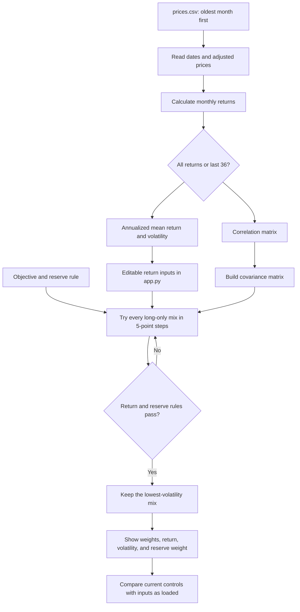

# Lab 15 — Portfolio Stability Decision

## Decision question

**Which mix carries the least risk while meeting the mandate — and does the
answer survive a one-point change in one estimate?**

The app is in [`app.py`](app.py), and all calculations are imported from
[`portfolio.py`](portfolio.py). Run it from the repository root:

**Live app:** [Portfolio Stability Decision](https://karim-portfolio-stability.streamlit.app/)

```bash
streamlit run app.py
```

The page identifies itself as an AI-assisted learning demonstration, not
investment advice. Expected returns estimated from prices are explicitly
labelled historical estimates rather than forecasts.

## Engine flowchart



`portfolio.py` also retains the separate Lab 14 path that prints the benchmark,
equal-weight, and inverse-volatility portfolios exactly as before.

## Meridian known-answer proof

The search is long-only, fully invested, and exhaustive on a 5-point grid. It
requires expected return of at least 6.5% and reserve-eligible weight of at
least 3%. Treasury bills and the Treasury 10-year note are checked as
reserve-eligible.

| Run | Bills / 10-year / IG / equity | Return | Volatility | Largest change |
|---|---:|---:|---:|---:|
| Inputs as loaded | 0 / 20 / 25 / 55 | 6.51% | 9.44% | — |
| Equity expected return 8.0% → 7.0% | 0 / 10 / 10 / 80 | 6.53% | 12.94% | 25 points |

The one-point reduction in the equity estimate moves 25 percentage points of
the portfolio's largest weight. The optimizer must use much more equity to
clear the unchanged 6.5% return threshold, even though doing so raises risk.

To prove the page uses the engine rather than a second copy of the math, both
IG–equity cells were changed to 0.50 on a test copy of the engine inputs. The
app calculation moved to **0 / 40 / 0 / 60**, with **6.52%** expected return
and **9.73%** volatility. The saved inputs remain at 0.25.

Running `python portfolio.py` still prints Tuesday's values unchanged. The
automated tests cover the loaded answer, the one-point stress, and the 0.50
correlation proof.

## Fund universe and data sources

The Project 2 universe selected by the student is SGOV, VGIT, BND, and VT. All
prices are monthly adjusted closes. The saved file has one date column, one
column per ticker, and 61 complete monthly observations in ascending order
from 2021-09-01 through 2026-09-01. It was downloaded on **2026-10-22**. The
incomplete October 2026 month was excluded.

| Ticker | Fund and role | Source | Download date |
|---|---|---|---|
| SGOV | iShares 0–3 Month Treasury Bond ETF; cash and reserve | [Yahoo Finance history](https://finance.yahoo.com/quote/SGOV/history/) | 2026-10-22 |
| VGIT | Vanguard Intermediate-Term Treasury ETF; government bonds and reserve | [Yahoo Finance history](https://finance.yahoo.com/quote/VGIT/history/) | 2026-10-22 |
| BND | Vanguard Total Bond Market ETF; broad investment-grade fixed income | [Yahoo Finance history](https://finance.yahoo.com/quote/BND/history/) | 2026-10-22 |
| VT | Vanguard Total World Stock ETF; global equity | [Yahoo Finance history](https://finance.yahoo.com/quote/VT/history/) | 2026-10-22 |

The student's objective is at least 6.5% expected return while keeping risk as
low as possible. SGOV and VGIT are reserve-eligible, and the hard constraint is
a minimum 3% combined reserve-eligible weight.

## Historical estimates and stability result

The app computes arithmetic mean monthly return × 12, sample monthly standard
deviation × √12, and correlations from the same monthly returns. These are
historical estimates, not forecasts.

| Window | Return estimates: SGOV / VGIT / BND / VT | Lowest-risk mix: SGOV / VGIT / BND / VT | Mix return | Volatility | Reserve |
|---|---:|---:|---:|---:|---:|
| All 60 monthly returns | 3.72 / -0.29 / -0.42 / 11.90% | 65 / 0 / 0 / 35 | 6.58% | 5.29% | 65% |
| Last 36 monthly returns | 4.44 / 3.52 / 4.10 / 20.25% | 85 / 0 / 0 / 15 | 6.81% | 1.79% | 85% |

The largest allocation change is **20 points**, in both SGOV and VT. The
last-36-month estimate gives VT a much higher historical mean return, so the
grid search needs less VT to reach 6.5%. That does not make the newer estimate
a forecast or establish that the 85/15 mix will remain low risk.

## Student and partner evidence

### No-screen mandate explanation

For my Project 2, I chose SGOV, VGIT, BND, and VT. I chose these funds because
they provide a mix of cash, government bonds, investment-grade bonds, and
global stocks. They also have relatively low expense ratios, and BND gives me
broader bond diversification. My main goal is to achieve at least a 6.5%
expected return while keeping the risk as low as possible. One important
requirement is that at least 3% of the portfolio must be invested in
reserve-eligible assets, which are SGOV and VGIT in my case.

### Paper engine drawing

The student confirmed that the process was drawn on paper, discussed, and shown
to the partner. No specific difference between the paper drawing and Mermaid
chart was recorded, so none is invented here.

### No-AI code explanation

The student confirmed that the work was discussed with and shown to the
partner. The partner reported that everything looked good. No specific partner
question was recorded, so this record does not invent one.

### Partner attack

The partner reviewed the work and reported that everything looked good, but no
partner-selected estimate change was recorded. This is a limitation against
the requested partner-attack procedure.

As separate reproducible sensitivity evidence, a one-point reduction in VT's
all-month historical return estimate—from 11.8952% to 10.8952%—changed the mix
from 65 / 0 / 0 / 35 to **60 / 0 / 0 / 40** for SGOV / VGIT / BND / VT. The
changed mix has a **6.59%** expected return, **6.03%** volatility, **60%**
reserve-eligible weight, and a largest weight change of **5 points**. This test
was computed from the engine and is not represented as the partner's action.

This makes me less confident about using the allocation immediately because
even one change in expected returns can affect the entire portfolio. I think
we should test different scenarios before deciding whether the allocation is
reliable enough to use.

### Estimation risk — learn on your own

Estimation risk means that the numbers used to predict future returns and risks
might not be accurate. Since the optimizer relies on these estimates, even a
small difference can make it choose a completely different allocation. With
the final SGOV/VGIT/BND/VT universe, comparing all 60 monthly returns with the
last 36 produces a 20-percentage-point change in both SGOV and VT. This shows
how much the optimizer depends on the data supplied and why one result should
not be trusted without further testing.

### Reflection and call

I choose **pilot** because the app is useful, but I would not fully trust its
allocation yet. Changing the historical period or expected-return estimates
can cause significant changes in portfolio weights. Even though the selected
funds are relatively low-cost and diversified, that does not make the
optimizer's result stable.

Before adopting it, I would test different expected-return assumptions and see
whether the allocation remains relatively stable. If the stress tests show
weight changes below 10 percentage points while the portfolio continues to
meet the 6.5% return target and 3% reserve requirement, I would be more
comfortable adopting it. If small input changes continue to produce large
allocation differences, I would keep it as a pilot.

## Verification

The repository checks are run with:

```bash
python -m unittest discover -s tests -v
```

They preserve the Lab 14 values, validate bad correlation inputs, reproduce
all three Lab 15 Meridian results, and exercise both CSV estimation windows.

## AI-use disclosure

OpenAI Codex added and tested the reusable search and CSV-estimation functions,
built the Streamlit interface, generated the Mermaid version of the engine,
and organized the executable evidence in this record. The no-screen, paper,
line-by-line explanation, partner attack, learn-on-your-own response, and final
decision evidence must come from the student and partner rather than AI.
